<a href="https://echeance.github.io/">
  <picture><source media="(prefers-color-scheme: dark)" srcset="assets/hero-dark.svg"></picture>
</a>

  <a href="https://echeance.github.io/"><b>Portfolio</b></a>
  &nbsp;·&nbsp;
  <a href="https://www.linkedin.com/in/nathan-ghys-3a8505433">LinkedIn</a>
  &nbsp;·&nbsp;
  <a href="mailto:ympax14@gmail.com">ympax14@gmail.com</a>
  &nbsp;·&nbsp;
  Arles, France

 

<i>Mon portfolio existe en cinq mises en scène. Choisissez la vôtre :</i>

  <a href="https://echeance.github.io/templates/overworld/"></a>
  <a href="https://echeance.github.io/templates/memoires/"></a>
  <a href="https://echeance.github.io/templates/frequences/"></a>
  <a href="https://echeance.github.io/templates/chambre-noire/"></a>
  <a href="https://echeance.github.io/templates/planches/"></a>

 

<a href="https://github.com/echeance/Avenoir">
  <picture><source media="(prefers-color-scheme: dark)" srcset="assets/now-dark.svg"></picture>
</a>

  

  <a href="https://github.com/echeance/DeltaRise"><picture><source media="(prefers-color-scheme: dark)" srcset="assets/card-deltarise-dark.svg"></picture></a>
  <a href="https://echeance.github.io/templates/overworld/#etape-10"><picture><source media="(prefers-color-scheme: dark)" srcset="assets/card-facelog-dark.svg"></picture></a>
  <a href="https://github.com/echeance/NeverLessSpigot"><picture><source media="(prefers-color-scheme: dark)" srcset="assets/card-neverless-dark.svg"></picture></a>
  <a href="https://echeance.github.io/templates/overworld/#etape-3"><picture><source media="(prefers-color-scheme: dark)" srcset="assets/card-rinaorc-dark.svg"></picture></a>
  <a href="https://echeance.github.io/templates/overworld/#etape-4"><picture><source media="(prefers-color-scheme: dark)" srcset="assets/card-emerixe-dark.svg"></picture></a>
  <a href="https://github.com/echeance/S2.02"><picture><source media="(prefers-color-scheme: dark)" srcset="assets/card-navyra-dark.svg"></picture></a>

 

<picture><source media="(prefers-color-scheme: dark)" srcset="assets/studio-dark.svg"></picture>

  

<a href="mailto:ympax14@gmail.com">
  <picture><source media="(prefers-color-scheme: dark)" srcset="assets/footer-dark.svg"></picture>
</a>

<!-- Les visuels sont générés par build/build.mjs (node build/build.mjs). -->
