  <a href="https://echeance.github.io/"><b>Portfolio</b></a>
  &nbsp;·&nbsp;
  <a href="https://www.linkedin.com/in/nathan-ghys-3a8505433">LinkedIn</a>
  &nbsp;·&nbsp;
  <a href="mailto:ympax14@gmail.com">ympax14@gmail.com</a>
  &nbsp;·&nbsp;
  Arles, France

 

<i>Mon portfolio existe en cinq mises en scène. Choisissez la vôtre :</i>

  
  
  
  
  

 

  

  
  
  
  
  
  

 

  

<!-- Les visuels sont générés par build/build.mjs (node build/build.mjs). -->
